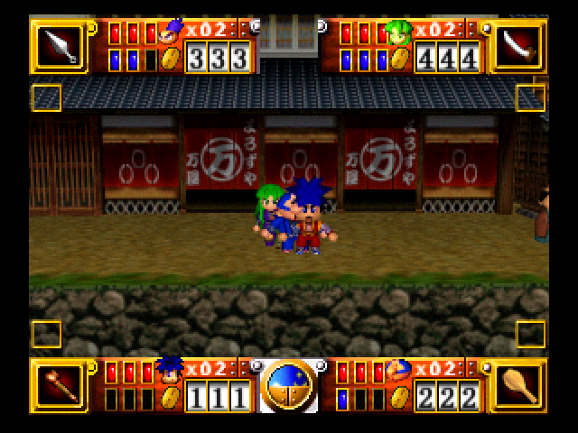
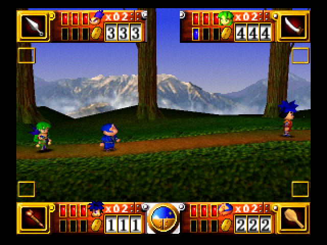
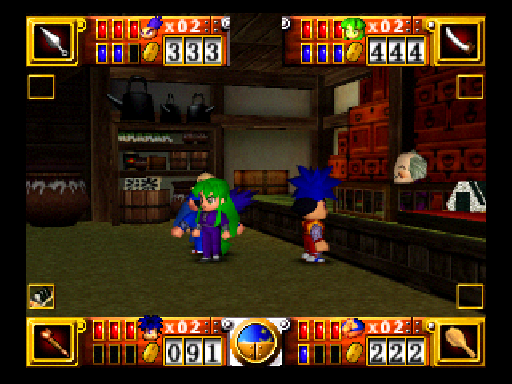
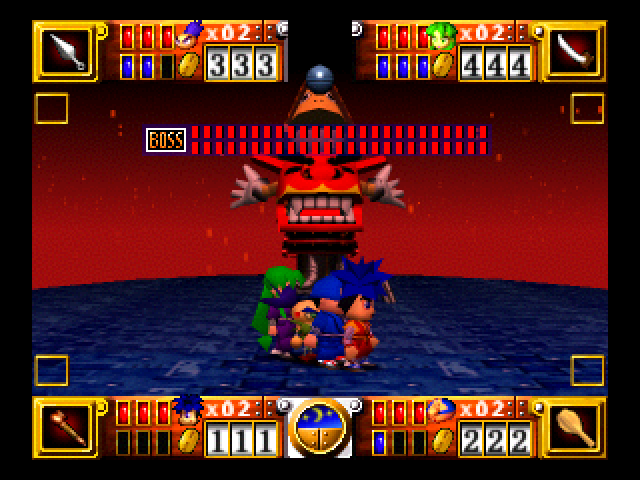

# Four From the Start

**A four-player co-op patch for Goemon's Great Adventure (Nintendo 64, USA).**
Version 1.0, 2026-10-15.

Goemon's Great Adventure has a four-player mode, but the original keeps it locked until you have collected all 44
entry passes, and even then players 3 and 4 are temporary guests: they have no HUD, and they are dropped at every
area change. This patch makes four-player co-op a normal way to play the whole game, from a new journal.

| | |
|---|---|
|  |  |
|  |  |

## What it does
- **Four players from a new game.** Choose **2P** on the title screen with three or four controllers plugged in:
  every connected controller gets a cursor on the character screen, and all four characters (Goemon, Ebisumaru,
  Sasuke, Yae) can be picked. With two controllers it is the normal 2-player game.
- **A HUD for players 3 and 4.** P3 gets a full panel at the top left and P4 at the top right, like P1/P2's at the
  bottom: portrait, lives, hearts, money and weapon. Each player has their own food slot; with three or four players
  the food slots become small boxes at the screen edges. One- and two-player games keep the original HUD.
- **Players 3 and 4 stay.** They move with the group from area to area and keep their lives, health, weapon and food.
- **Drop in any time, without the 44 passes.** Controller 3 or 4 joins with **C-Right + Start** (in a stage or town;
  not in houses, shops or on the world map, as in the original). The joiner becomes the next free player, so players
  are always numbered 1 to 4 without gaps, and starts with player 1's weapon level.
- **Everyone keeps their own money and items.** Each player buys in shops with their own coins, and a journal saved
  with four players gives each of them their own coins, armour, weapon and food back.
- **Impact battles with four.** Players 1 and 2 fly Impact as in the original; players 3 and 4 fire the coin cannon
  with **Z**, as player 2 can.
- **More room for three or four.** In the original, players can't move further apart than the camera's view. With
  three or four players the camera now zooms out smoothly as the group spreads (up to 1.25×) and back in when you
  regroup. With one or two players the view is exactly the original.
- **Boss fights:** with three or four players the BOSS bar is drawn lower, below the P3/P4 panels.
- **Sasuke and Yae while you play together.** With three or four players all four characters can be picked; your
  journal still records the story's own progress, so loaded alone it offers only the characters the story has given.

## How to play
1. Get your own **USA** ROM of Goemon's Great Adventure in `.z64` format (big-endian). Its SHA-1 should be
   `9f9e860816f9e2a68bb5f4f56086e0c7450c64d7`. This repository does not contain or link to the game.
2. Apply `patches/four-from-the-start-v1.0.bps` with a BPS patcher such as
   [Flips](https://www.romhacking.net/utilities/1040/) or [Rom Patcher JS](https://www.marcrobledo.com/RomPatcher.js/).
   The patched ROM's SHA-1 is `2fd8e78daa464b6fdbfc7f4fee7ef29f60a28099`.
3. Plug in three or four controllers, with a Controller Pak in controller 1 (the game saves only to a pak), choose
   **2P** and a journal, and pick a character with each controller.
4. To save, talk to the innkeeper in Lost'n Town (the inn is at the left end of town) and choose **Journal**.

## Files
| File | Apply to | Result |
|---|---|---|
| `patches/four-from-the-start-v1.0.bps` | USA ROM, SHA-1 `9f9e8608…4d7` | v1.0, SHA-1 `2fd8e78daa464b6fdbfc7f4fee7ef29f60a28099` |
| `patches/four-from-the-start-v0.3.bps` | same | v0.3, SHA-1 `9b1468947f27e05eb8e2a44f4b1f8c2830c79e49` |
| `patches/four-from-the-start-v0.2.bps` | same | v0.2, SHA-1 `759226563ac818defb255476f6c56bcff752053b` |
| `patches/four-from-the-start-v0.1.bps` | same | v0.1, SHA-1 `1a87e059328a19f3db3d8ba32e3b7eec39ccb13a` |

Every change is listed in words (addresses and instructions) in [CHANGES.md](CHANGES.md).

## Tested
Tested in **Project64 3.0.1** by an automated test rig, not yet on real hardware or in other emulators:
- four players from the title screen; joining as the next free player; a joiner's weapon level;
- the HUD panels and food boxes; the boss bar at the Edo Castle boss, with players 3 and 4 alone damaging the boss;
- each player buying in a shop with their own coins; a four-player journal saved, the emulator restarted, and
  everyone's coins, armour, weapon and food back on reload;
- players 3 and 4 firing the cannon in an Impact battle; the camera zoom;
- all 67 stages, towns, castle rooms and boss arenas entered with four players.

## Known limits
- Not tested for players 3/4's damage: Ryugu Castle's boss and the final boss's second phase. Both use the same
  attack code as the bosses that were tested.
- No joining inside houses, shops, cutscenes or on the world map (the game's own rule).
- The zoom stays off in the checkpoints and the first boss fight, whose cameras the game controls itself.
- Real hardware (flashcarts) and emulators other than Project64: not tested. Reports are welcome in the issues.

## Credits
gallaux, whose 4-player unlock showed that the gate was patchable. rommy, the compression tool every build goes
through, from the [Mystical Ninja Starring Goemon decompilation](https://github.com/klorfmorf/mnsg) (klorfmorf),
adapted for this game in [StopSine/gga](https://github.com/StopSine/gga) along with its disassembly. The Hack64 notes
author (RAM map). Almar's Guides (stat and unlock addresses).
Much of the reverse engineering and testing was done with an AI assistant (Claude).

Goemon's Great Adventure is © Konami. This is an unofficial fan patch; no game data or ROMs are distributed here.
